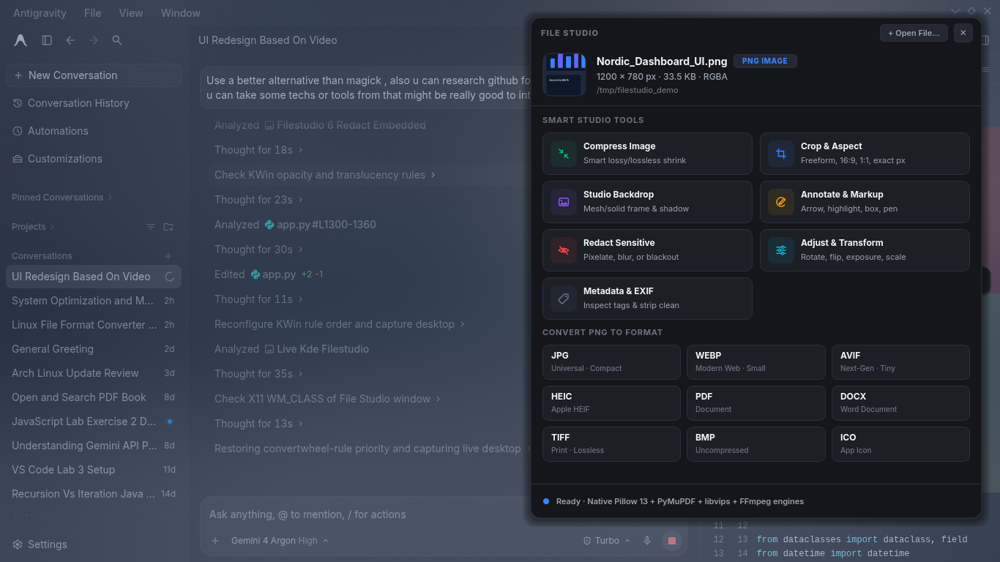
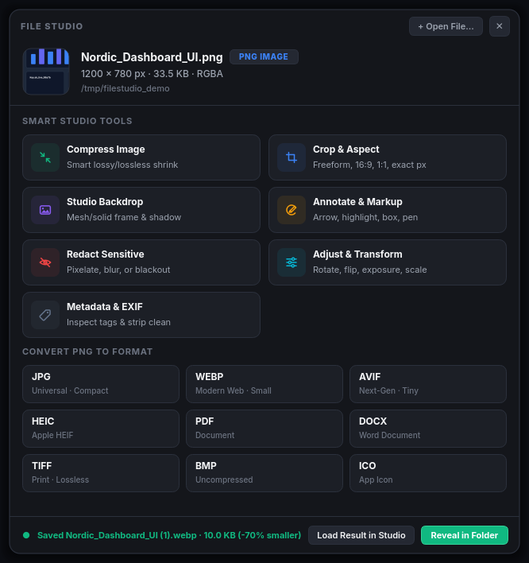
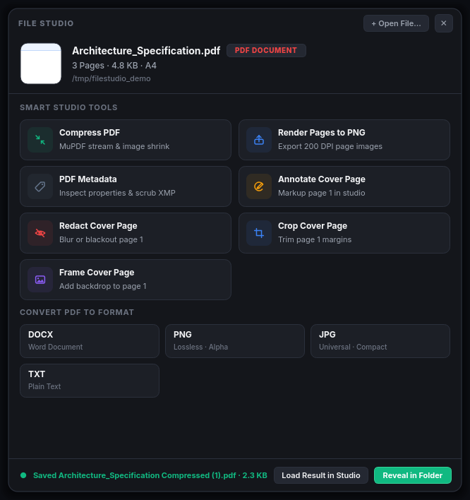
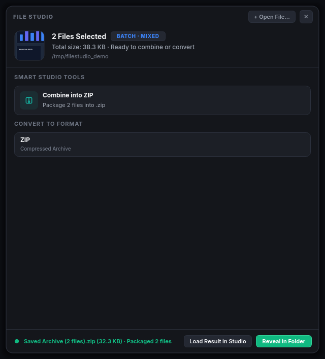
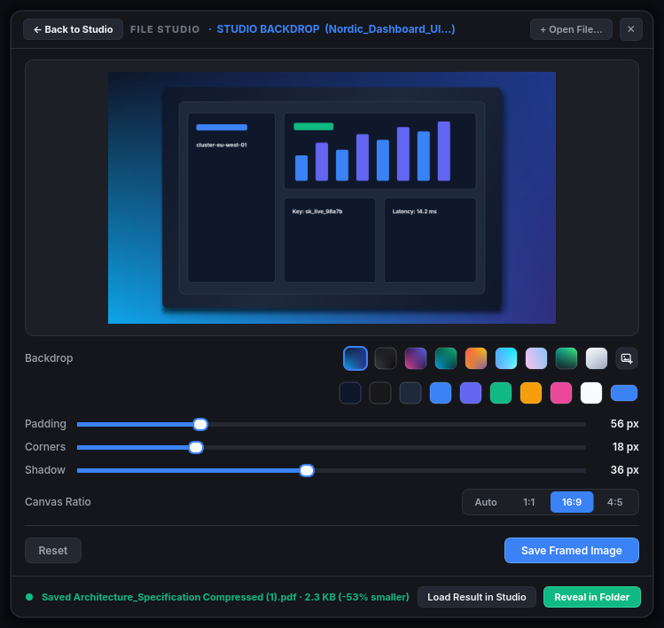
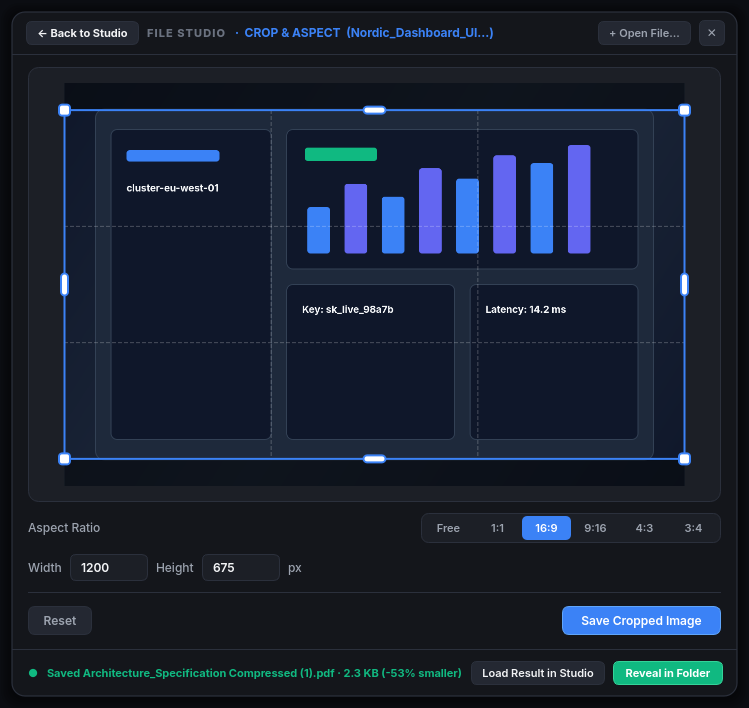
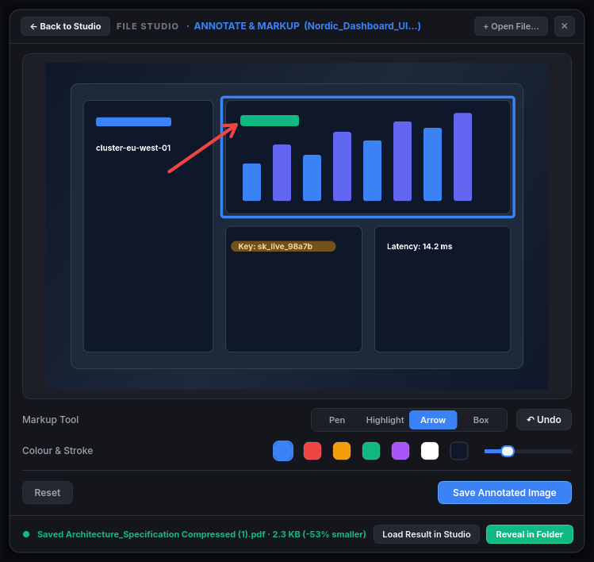
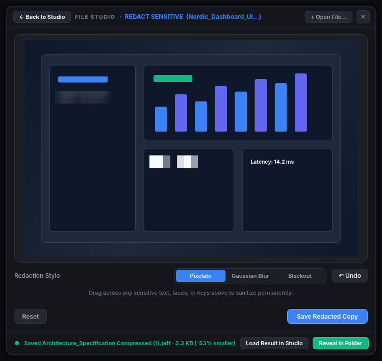
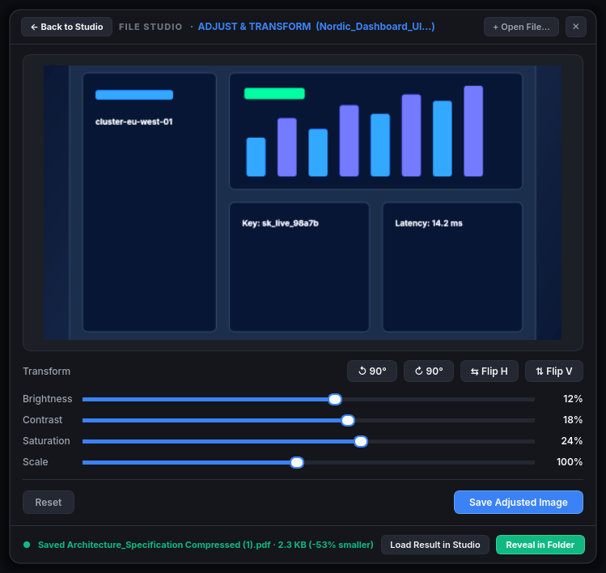
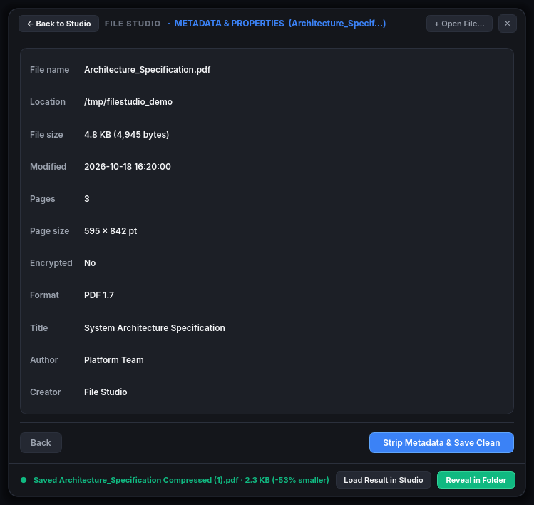

# File Studio

<p align="center">
  
</p>

<p align="center">
  <strong>Intelligent, dark-native rectangular file toolkit & non-destructive format studio for Linux (KDE Plasma 6).</strong>
</p>

<p align="center">
  
  
  
  
  
</p>

---

## Overview

**File Studio** is a structured, dark-native file converter, compressor, and creative editing studio designed specifically for Linux desktop environments (optimized for KDE Plasma 6). 

Unlike legacy multi-megabyte shell scripts or slow ImageMagick subprocess wrappers, File Studio is built on **high-performance, in-memory C-backed engines** (Pillow 13, libvips, PyMuPDF, and FFmpeg) combined with deep desktop integration:

- **Obsidian & Cobalt Slate Aesthetic**: Purpose-built for dark desktop environments (`#14161B` surface, `#1C1F26` cards, `#2B303C` 1px borders, `#3B82F6` Cobalt Blue accents, `#10B981` Emerald status badges).
- **File Intelligence**: The moment you drop or open a file, File Studio probes its exact technical specs (dimensions, colour space, page counts, paper sizes, audio/video codecs, bitrates, archive contents).
- **Context-Aware Command Deck**: Strictly displays compatible tools and target formats tailored to the probed file kind—never forcing image tools onto videos, PDFs, or archives.
- **Embedded Studio Views**: Interactive tools (Crop, Studio Backdrop, Annotate, Redact, Adjust, Metadata) switch seamlessly inline inside the same rectangular window with zero popup clutter.
- **Batch & Archive Intelligence**: Drag multiple files to combine them instantly into a clean `.zip` archive or batch-convert them.
- **KDE Dolphin ServiceMenus**: Native right-click context menus in Dolphin filtered strictly by MIME type.

---

## Screenshots & Feature Tour

### 1. Context-Aware Command Decks

| Single Image Inspection | PDF Probing & Tools |
| :---: | :---: |
|  |  |
| *Live 60×60 thumbnail, dimensions, colour mode, 7 image tools, and 9 target formats with inline WebP conversion savings.* | *Automatic PDF adaptation: page counts, A4 paper size, MuPDF stream compression, and 200 DPI page rendering.* |

### 2. Multi-File Batch & ZIP Packaging

<p align="center">
  
  <br />
  <em>Select multiple files (same type or mixed) to combine them into a single clean <code>.zip</code> archive with one click.</em>
</p>

### 3. Inline Embedded Studios

Interactive tools run directly inside the main rectangular window via an embedded `QStackedWidget`, with a persistent `← Back to Studio` button in the header bar.

| Studio Backdrop & Frame | Crop & Aspect Ratio |
| :---: | :---: |
|  |  |
| *Deep Cobalt Aurora mesh gradients, custom padding, rounded corners, drop shadows, and aspect ratio locks.* | *Rule-of-thirds grid, Cobalt Blue corner handles, aspect ratio presets (16:9, 1:1, 9:16), and exact pixel inputs.* |

| Annotate & Markup | Redact Sensitive Information |
| :---: | :---: |
|  |  |
| *Vector arrows, highlight markers, callout boxes, and freehand pen drawing.* | *Permanent pixelation, Gaussian blur, and solid blackout sanitization for tokens, keys, and personal data.* |

| Adjust & Transform | Metadata & Properties |
| :---: | :---: |
|  |  |
| *90° rotation, horizontal/vertical flip, brightness, contrast, saturation, and scaling.* | *Native EXIF, XMP, stream, and codec tag inspection with one-click metadata scrubbing.* |

---

## Native C-Backed Engine Architecture

Inspired by mature open-source projects (**GNOME Switcheroo**, **Curtail**, and **PyMuPDF**), File Studio runs zero ImageMagick (`magick`) subprocesses:

| Domain | Legacy Approach | File Studio Native Engine | Performance & Benefit |
| :--- | :--- | :--- | :--- |
| **Raster & Next-Gen Images** | Shelling out to `magick` | **Pillow 13 + pillow-heif + libvips (`pyvips`)** | 10× faster in-memory encoding/decoding for PNG, JPG, WebP, AVIF, HEIC, TIFF, BMP, ICO. |
| **Image Compression** | `magick -colors 256` | **libimagequant / FastOctree quantization** | **60–75% PNG size reduction** (Curtail technique) with alpha channel preservation. |
| **PDF Manipulation** | `pdftoppm`, `pdftotext`, `gs` | **PyMuPDF (`pymupdf` 1.28 C engine)** | Instant page probing, 200 DPI rendering, text extraction, and garbage-collected stream compression. |
| **Word Document Generation** | Raw shell script zipping | **`python-docx` + Pillow** | Clean, standards-compliant `.docx` document generation. |
| **Video & Audio** | Ad-hoc CLI calls | **FFmpeg + FFprobe** | Fast CRF-28 H.264 video compression, high-efficiency VP9 WebM, and audio transcoding. |

---

## Installation

### Prerequisites
- Python $\ge$ 3.10
- PyQt6
- `libvips` (available in standard repositories on Arch, Fedora, Debian/Ubuntu)
- `ffmpeg`

On Arch Linux:
```bash
sudo pacman -S python python-pyqt6 libvips ffmpeg
```

On Fedora:
```bash
sudo dnf install python3 python3-pyqt6 vips-devel ffmpeg
```

On Ubuntu / Debian:
```bash
sudo apt install python3 python3-pyqt6 libvips-dev ffmpeg
```

### Quick Install (Automated)
Clone the repository and run the installer:
```bash
git clone https://github.com/Mqsirrel/file-studio.git
cd file-studio
chmod +x install.sh
./install.sh
```

The installer will:
1. Create a dedicated Python virtual environment inheriting system PyQt6.
2. Install `pymupdf`, `pyvips`, `pillow`, `pillow-heif`, `python-docx`, and `pypdf`.
3. Install the `convertwheel` and `file-studio` binaries into `~/.local/bin/`.
4. Install the KDE Dolphin right-click ServiceMenus into `~/.local/share/kio/servicemenus/`.
5. Enable and start the background user systemd service.

---

## Usage

### 1. From KDE Dolphin (Right-Click Context Menu)
Select any file (or multiple files) in Dolphin, right-click, and open the **File Studio** submenu:
- **Images**: Crop, Studio Backdrop, Annotate, Redact, Adjust, Compress, Strip EXIF, or Convert to WEBP / PNG / JPG / AVIF / PDF.
- **PDFs**: Compress PDF, Render Pages to PNG (200 DPI), Extract Plain Text, Convert to Word (`.docx`), Scrub Metadata.
- **Media**: Compress Media, Convert to MP4, Convert to MP3, Convert to Animated GIF.
- **Documents**: Convert to PDF, Convert to Word, Extract Text.
- **Multiple Files**: Choose **Combine into ZIP Archive** to package everything instantly.

### 2. Desktop Window & Edge Dock
- **Edge Dock**: A discreet 38px dark pill docked at your screen edge. Drag and drop any file onto it to launch File Studio immediately.
- **File Studio Window**: Drag and drop files anywhere onto the window, or click **`+ Open File…`** to browse.

### 3. Command Line Interface (CLI)
```bash
# Open any file in the File Studio Command Deck
convertwheel path/to/image.png

# Open directly into an interactive tool
convertwheel --crop path/to/image.png
convertwheel --addbg path/to/image.png
convertwheel --annotate path/to/image.png
convertwheel --redact path/to/image.png
convertwheel --edit path/to/image.png
convertwheel --metadata path/to/document.pdf

# Quick conversion via background worker with desktop notification
convertwheel --to WEBP path/to/photo.jpg
convertwheel --to PNG path/to/document.pdf

# Smart lossy/lossless compression
convertwheel --compress path/to/huge_image.png
convertwheel --compress path/to/report.pdf

# Combine multiple files into a single .zip archive
convertwheel --zip file1.png file2.pdf file3.docx
```

---

## License

This project is open-source software licensed under the [MIT License](LICENSE).
